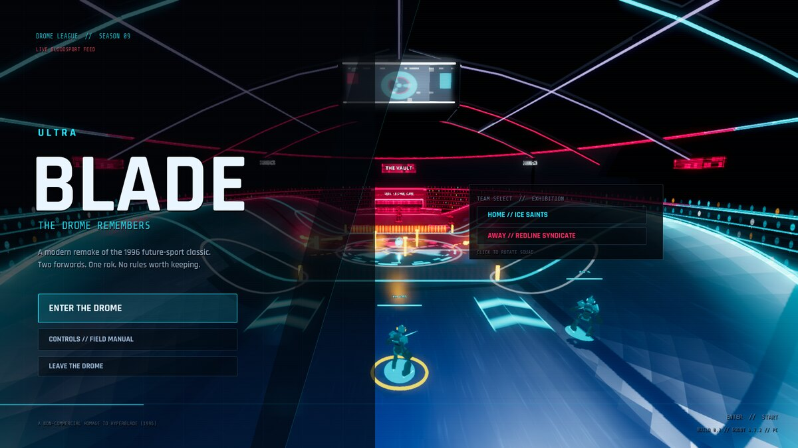
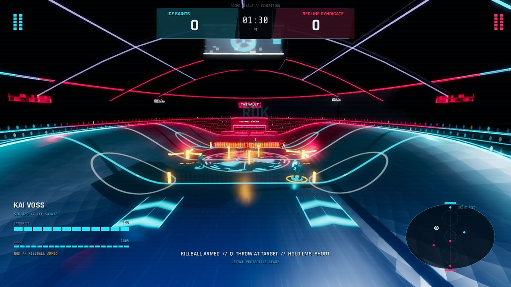
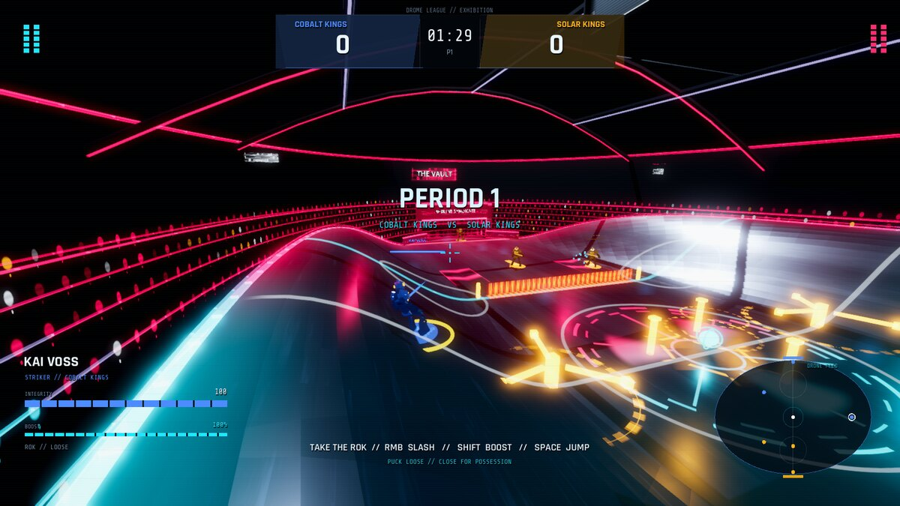
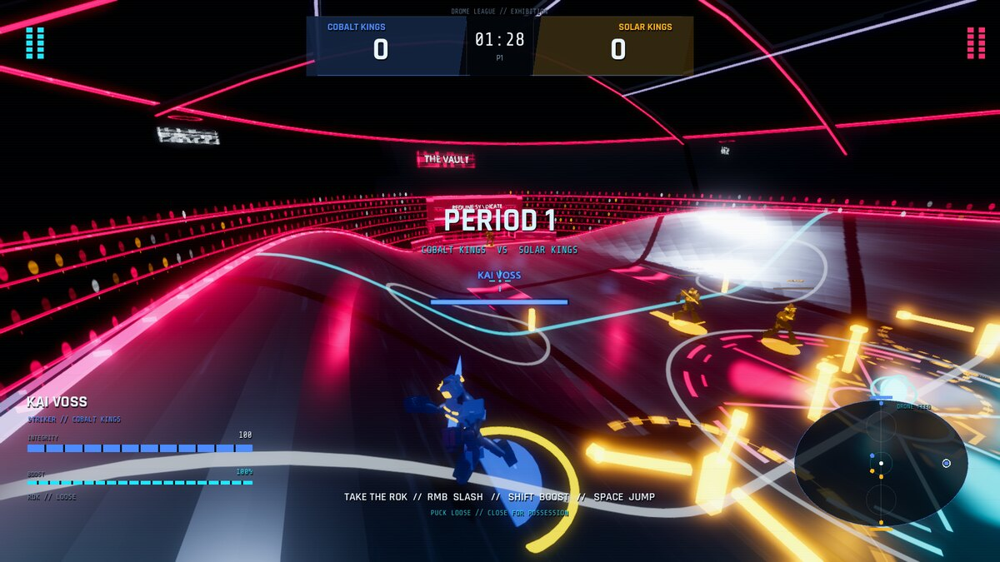
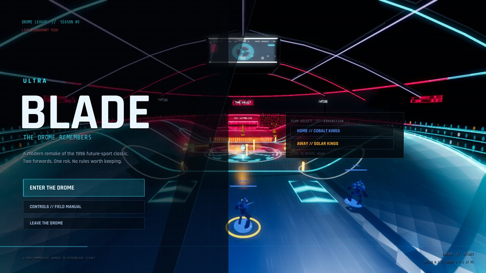
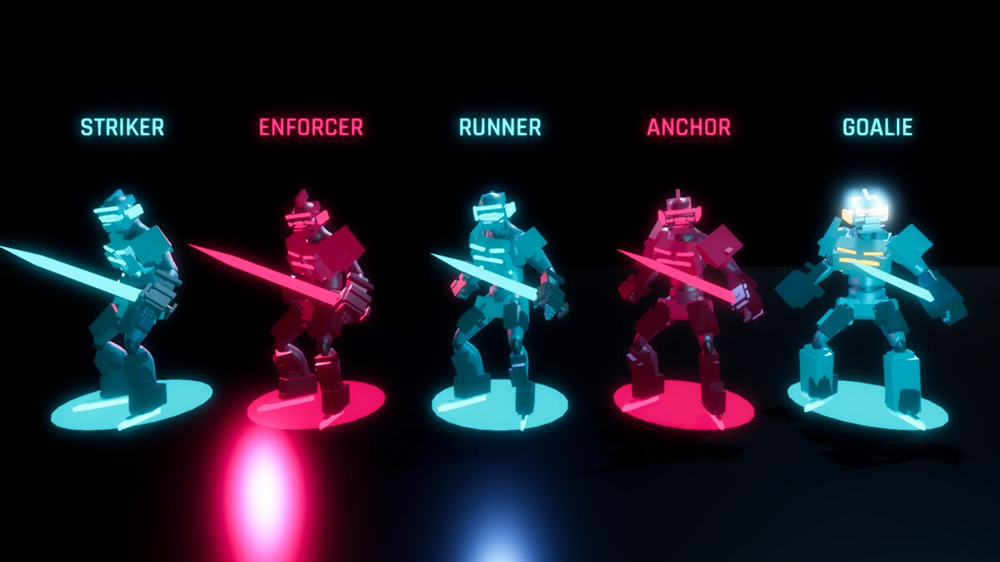
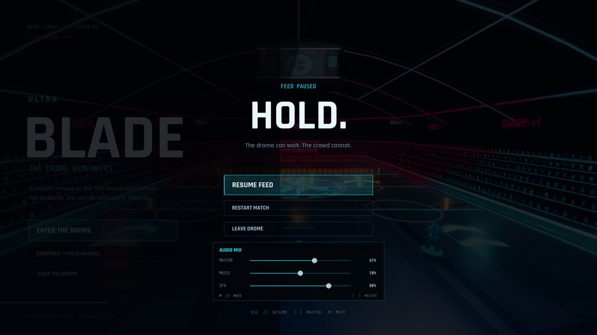

# ULTRABLADE

**A modern remake of the 1996 cult classic _HyperBlade_ — a violent future sport played on an elliptical ice drome.**

Skate. Slash. Steal the rok. Feed the killball. Score before the other team takes your forwards apart.



## Play it (Windows PC)

The playable build is `build/UltraBlade.exe` (embedded PCK, no install).

```powershell
# From this repo, once built:
.\build\UltraBlade.exe

# Or build and launch through the helpers:
.\scripts\build_ultrablade.ps1
.\scripts\run_ultrablade.ps1
```

Requires Godot **4.7.2** when running from source. The project lives in `game/`; open it with
`godot --path game` or run `godot_console.exe --path game`.

A 1600×900 window is used by default. The game is built for Windows PC with Forward+ rendering.

## The sport

ULTRABLADE is a fast, physical future-hockey game: two active skaters and an invulnerable goalie
per side, a **rok** that can be carried, passed, shot and charged into a **killball**, and a drome
full of hazards. Three periods of 90 seconds decide the match; if the score is tied, 45 seconds of
sudden-death overtime follow. Downed skaters return at the next goal or period. Kill both enemy
forwards and then score to win by **ANNIHILATION**.

The core loop is faithful to the original: **outscore them, or dismantle them.** The modern layer
is presentation and feel: the ActionForge-animated skaters, a neon broadcast drome, goal
cinematics, impact feedback, a readable combat HUD, a minimap, kill feed and an original
procedural score.

THE VAULT is now a **curved elliptical bowl**, not a flat rink: a low goal-to-goal lane sweeps up
into 4.2 m skateable banks on both sides, with a continuous elliptical rim and crowd bowl. Skaters
climb and jump the banks, the camera clears the surface, and the rok rides the same height field.
The shape is based on frame analysis of the original HyperBlade drome footage in
[docs/HYPERBLADE-VIDEO-NOTES.md](docs/HYPERBLADE-VIDEO-NOTES.md).

The skaters are deliberately lean and aggressive: gunmetal plating over a dark team suit, swept
shoulder blades, spiked crown helmets, slit visors, long serrated jaks and low, combat-ready
stances. Role builds exaggerate the silhouette — enforcers are broader and caged, runners are
slight, and goalies carry heavy pads and blockers.











## Controls

| Input | Action |
| --- | --- |
| `WASD` | Skate |
| `Mouse` | Look / aim |
| `Left Mouse` — no rok | Slash (jak) — damage and strip the rok |
| `Left Mouse` — with rok | Hold to charge a shot, release to fire |
| `Right Mouse` | Heavy slash — high damage, long recovery, drops the rok |
| `Shift` | Boost; stamina-limited; can body-check |
| `Space` | Jump hazard strips |
| `E` | Pass to your AI teammate |
| `Q` | Throw a charged killball at the nearest opponent |
| `Esc` | Pause / resume |
| `R` | Restart from pause or the end screen |
| `M` | Mute / unmute |
| `[` / `]` | Lower / raise master volume |
| `Enter` | Start / rematch from the title or end screen |
| `Mouse` — title menu | Click **HOME** / **AWAY** to rotate the matchup squad |

Volume and mix are also available in the pause menu: **MASTER**, **MUSIC** and **SFX** sliders. Settings are persisted to `user://settings.cfg` between runs.

**The game starts muted by default.** Press `M` to unmute, or raise the master slider / press `]`.

Closing the window or alt-tabbing releases mouse capture, and the game restores a visible cursor on exit.



## Match rules in this slice

- **Four home squads** and **four away squads**, selectable from the title menu; the default is
  **ICE SAINTS vs REDLINE SYNDICATE**
- 2 outfield skaters + 1 invulnerable goalie per side
- 3 × 90 s periods; clock stops during goals; 45 s sudden-death overtime on a tie
- Goal = 1 point; the killball is the high-risk, high-damage option
- Downed skaters are out until the next goal/period (reserve rotation)
- **Annihilation:** both enemy forwards down + a goal ends the match immediately
- One arena (**THE VAULT**), eight league squads, one AI difficulty profile — a vertical slice,
  not a full league

## Status

Playable vertical slice, built and tested on Godot 4.7.2 / Windows with a T600 4 GB GPU.
Single-player vs AI only. No gamepad, online multiplayer, season or roster progression in this
slice. See [docs/GAME-DESIGN.md](docs/GAME-DESIGN.md) for the scope and
[docs/EVIDENCE.md](docs/EVIDENCE.md) for what was actually verified.

## Repository layout

- `game/` — Godot 4.7.2 project (PC), runtime assets under `game/assets/`
- `docs/` — engine decision, game design, art direction, sourced HyperBlade reference, evidence
- `scripts/` — run/build/verify helpers
- `project.gypsy.json` — Gypsy Studio project manifest
- `artifacts/` and `build/` — generated, gitignored

## Verified locally

```powershell
.\scripts\verify_ultrablade.ps1     # selftest + end-to-end integration + AI demo
.\scripts\build_ultrablade.ps1      # export build/UltraBlade.exe
python scripts\check_repo.py         # UTF-8/no-CR and Markdown-link hygiene
```

The detailed commands, results, budgets and known limitations are in
[docs/EVIDENCE.md](docs/EVIDENCE.md).

## Credits and licences

- Character rig and animation clips: **ActionForge** CC0 animation library (clips by Quaternius).
  Source: <https://actionforge.app/>. The fetched files and provenance are in
  `game/assets/actionforge/`.
- UI fonts: **Rajdhani** and **Share Tech Mono**, SIL Open Font License 1.1; licence files are in
  `game/assets/fonts/`.
- Audio: original procedural assets generated for this project (numpy synthesis, no samples or
  generative models). Provenance in `game/assets/audio/NOTICE.md`.
- Arena, shaders, code and game design: original work for this remake.
- _HyperBlade_ is a Wizbang!/Activision property. **This is a non-commercial homage, not
  affiliated with or endorsed by the rights holders.** See
  [docs/THIRD-PARTY-NOTICES.md](docs/THIRD-PARTY-NOTICES.md).

## Engine note

**Godot 4.7.2** was chosen for this project. The reasoning — speed of iteration, verified local
headless/build/capture loop, glTF support, 4 GB VRAM headroom and no runtime licence friction —
is recorded in [docs/ENGINE-DECISION.md](docs/ENGINE-DECISION.md). Unreal 5.8 fails this machine's
hardware gate; Unity 6 is a viable alternative but had no proven local asset/pipeline in this
workstudio.
